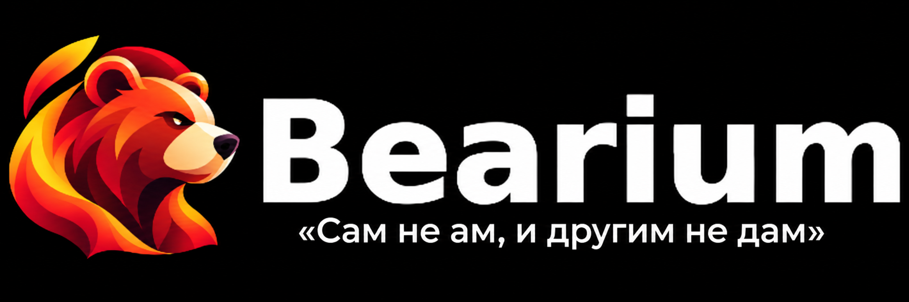

<p align="center">
  
</p>

<p align="center">
  <strong>Firefox для Android с ограниченной поддержкой Russian Trusted Root CA</strong>
</p>

<p align="center">
  <a href="https://github.com/ISAIandCO/Bearium/releases/latest">
    
  </a>
  <a href="https://apps.obtainium.imranr.dev/redirect?r=obtainium://add/https://github.com/ISAIandCO/Bearium">
    
  </a>
  <a href="https://github.com/ISAIandCO/Bearium/releases">
    
  </a>
  <a href="LICENSE">
    
  </a>
</p>

<p align="center">
  <a href="https://github.com/ISAIandCO/Bearium/releases/latest"><b>Скачать APK</b></a>
  ·
  <a href="https://github.com/ISAIandCO/Bearium/issues">Сообщить об ошибке</a>
  ·
  <a href="https://github.com/ISAIandCO/Bearium/discussions">Обсуждения</a>
</p>

---

## Что это

**Bearium** — независимая Android-сборка стабильного Firefox со встроенной поддержкой **Russian Trusted Root CA** и отдельной политикой, ограничивающей доверие этому корневому сертификату.

Обычный Firefox не считает Russian Trusted Root CA доверенным. Bearium добавляет его как **дополнительный корень только для проверки TLS-сертификатов HTTPS-сайтов**.

Это не означает безусловного доверия этому УЦ.

Если цепочка сертификата построена через Russian Trusted Root CA или содержит закреплённый промежуточный Russian Trusted Sub CA RSA 2022/2024, Bearium применяет дополнительные правила:

* для `.ru`, `.su` и `.рф` сертификат должен пройти дополнительную проверку SCT;
* для других доменных зон такое соединение блокируется, пока пользователь явно не создаст исключение;
* исключение Bearium не отменяет обычные проверки сертификатов Firefox;
* промежуточные УЦ при этом не добавляются в доверенное хранилище.

Если сайт использует сертификат из обычного хранилища Mozilla и выбранная цепочка **не содержит закреплённых российских УЦ**, дополнительные правила Bearium к нему не применяются.

> [!IMPORTANT]
> Russian Trusted Root CA встроен **только в Bearium**.
>
> Он не добавляется в системное хранилище Android, не становится доверенным для других приложений и не заменяет обычное хранилище сертификатов Mozilla.

---

## Модель доверия

У Bearium две независимые части проверки.

### 1. Обычная проверка Firefox

Для любого HTTPS-соединения продолжают действовать штатные проверки Firefox, включая:

* корректность криптографических подписей;
* имя сайта;
* срок действия сертификата;
* назначение сертификата;
* построение цепочки;
* отзыв сертификата.

Bearium эти проверки не отключает.

### 2. Дополнительная политика Russian Trusted Root CA

Она применяется **только к выбранной Firefox цепочке с точным закреплённым Russian Trusted Root CA или промежуточным Russian Trusted Sub CA RSA 2022/2024**. Промежуточные УЦ не добавляются в доверенное хранилище: их распознавание сохраняет дополнительные ограничения, если стороннее хранилище уже доверяет такому сертификату как якорю.

В этом случае Bearium дополнительно проверяет:

| Условие                                                              | Результат                                             |
| -------------------------------------------------------------------- | ----------------------------------------------------- |
| В выбранной цепочке нет закреплённых российских УЦ                   | Обычная логика Firefox                                |
| Есть закреплённый УЦ + `.ru`, `.su` или `.рф` + подходящий SCT         | Разрешено                                             |
| Есть закреплённый УЦ + `.ru`, `.su` или `.рф` без подходящего SCT      | Заблокировано                                         |
| Есть закреплённый УЦ + любая другая доменная зона                     | Заблокировано                                         |
| Есть пользовательское исключение Bearium                             | Обходится только выбранное дополнительное ограничение |
| Есть обычная ошибка TLS Firefox                                      | Соединение остаётся заблокированным                   |

Таким образом, исключение Bearium может ослабить **только собственные ограничения Bearium**.

Оно не может сделать валидным просроченный сертификат, сертификат с неправильным именем сайта, некорректной подписью или другой ошибкой стандартной TLS-проверки Firefox.

Для защищаемых цепочек каждый хост использует отдельное соединение с новой
TLS-проверкой: возобновление прежних TLS-сессий и объединение разных хостов
в одном HTTP/2 или HTTP/3 соединении запрещены. Если у сохранённой TLS-сессии
нет сведений о построенной цепочке, соединение также проверяется заново.

---

## Установка

### [Скачать последнюю версию](https://github.com/ISAIandCO/Bearium/releases/latest)

Выберите APK под архитектуру устройства:

| APK      | Устройство                                     |
| -------- | ---------------------------------------------- |
| `arm64`  | Большинство современных смартфонов и планшетов |
| `armv7`  | Старые 32-битные ARM-устройства                |
| `x86_64` | В основном эмуляторы и редкие x86-устройства   |

Если не знаете, какой вариант нужен — скорее всего, **arm64**.

Android может запросить разрешение на установку APK из браузера или файлового менеджера.

Bearium имеет отдельный пакет:

```text
app.bearium.browser
```

Поэтому он устанавливается рядом с официальным Firefox и не заменяет его.

---

## Как ведёт себя Bearium

В сборках Bearium отключена отправка телеметрии Glean, включая запуск браузера
и приветствие. Рекламные ярлыки на главной странице по умолчанию выключены;
ранее сохранённый выбор пользователя сохраняется. Штатные настройки защиты
от опасных сайтов и проверки отзыва сертификатов, а также обновления
расширений сохраняются.

Интерфейс использует иллюстрации медведя Bearium в приветствии, панели
безопасности, Labs, закладках, группах вкладок, синхронизации и виджете поиска.
Рисунки имеют прозрачный фон и адаптированы к светлой и тёмной темам.
При отключённых системных анимациях иллюстрация групп вкладок отображается
статично; оба варианта оставляют место для текста карточки.

HTTPS-Only включён по умолчанию; сохранённый выбор пользователя имеет приоритет.
После отказа TLS-проверки или ответа через отслеживаемый УЦ браузер не заменяет
этот переход автоматической HTTP-попыткой. Для действительно HTTP-only ресурсов
остаётся штатное управление HTTPS-Only.

В щите показывается, использует ли основная страница УЦ Минцифры, прошла ли
проверка SCT и действует ли исключение. В подробностях доступны сведения о
построенной цепочке; полученный при неудачном TLS-соединении список сертификатов
помечается отдельно и не подтверждает доверие.

Если при успешных сетевых ответах одного HTTPS-адреса источник доверия меняется
между отслеживаемой PKI и другим УЦ, появляется информационное уведомление.
Наблюдения хранятся только в памяти текущего сеанса; приватные наблюдения отделены
и очищаются при закрытии всех приватных вкладок. Уведомление не создаёт исключения
и само по себе не доказывает атаку. Оно появляется после получения ответа сайта.

### В выбранной цепочке нет закреплённых российских УЦ

Ничего дополнительного не происходит.

Сертификат проверяется обычными механизмами Firefox.

### Закреплённый российский УЦ используется для `.ru`, `.su` или `.рф`

Для цепочки через Russian Trusted Root CA или закреплённый Russian Trusted Sub CA RSA 2022/2024 требуется подходящий **SCT** — Signed Certificate Timestamp.

Проверяются SCT из сертификата, TLS и stapled OCSP по встроенному списку поддерживаемых журналов.

Если дополнительная проверка успешна и стандартная TLS-проверка Firefox также пройдена, соединение разрешается.

### Закреплённый российский УЦ используется вне `.ru`, `.su` или `.рф`

Например:

```text
example.com
github.com
example.org
```

Bearium блокирует такое соединение независимо от того, смог бы встроенный дополнительный корень подтвердить криптографическую цепочку.

Чтобы открыть такой сайт, пользователь должен явно создать исключение.

### Проверка SCT не пройдена

Соединение также блокируется.

Bearium показывает собственную страницу защиты с причиной блокировки и вариантами действий.

---

## Исключения

Исключения Bearium относятся **только к дополнительной политике закреплённых российских УЦ**.

Можно отдельно разрешить:

* использование этого УЦ за пределами `.ru`, `.su` и `.рф`;
* отсутствие подходящего SCT;
* оба ограничения.

Исключение относится к конкретному домену и не превращает Russian Trusted Root CA в глобально доверенный УЦ.

Доступны временные и постоянные исключения.

Одноразовое разрешение:

* привязано к конкретной вкладке;
* привязано к URL и хосту;
* хранится только в памяти;
* автоматически истекает.

Настройки защиты доступны через:

**щит в адресной строке → Защита сертификатов · CAnttRUst**

> [!NOTE]
> Исключение Bearium не является аналогом кнопки «игнорировать ошибку сертификата».
>
> Оно изменяет только дополнительные правила Bearium. Обычная TLS-проверка Firefox остаётся обязательной.

---

## Bearium и [CAnttRUst](https://github.com/ISAIandCO/CAnttRUst)

**CAnttRUst** — расширение для обычного Firefox с похожей идеей: отдельно контролировать использование Russian Trusted Root CA и не считать его применение нормальным для любого сайта.

Bearium реализует эту модель глубже — непосредственно внутри Gecko и интерфейса браузера.

|                         | CAnttRUst                              | Bearium                                         |
| ----------------------- | -------------------------------------- | ----------------------------------------------- |
| Формат                  | Расширение Firefox                     | Отдельный Android-браузер                       |
| Russian Trusted Root CA | Сам не добавляет доверие к сертификату | Имеет встроенный дополнительный корень для TLS  |
| Ограничение доменов     | Проверяется расширением                | Проверяется внутри браузера                     |
| SCT                     | Проверяется расширением                | Проверяется нативной политикой                  |
| Блокировка              | Страница расширения                    | Встроенная страница Bearium                     |
| Исключения              | Ослабляют правила расширения           | Ослабляют только дополнительные правила Bearium |

Если Russian Trusted Root CA уже доступен обычному Firefox и нужен только дополнительный контроль его использования, можно использовать:

### [CAnttRUst из Firefox Add-ons](https://addons.mozilla.org/ru/firefox/addon/9cac43aa9dd4421b8f0e/)

Bearium предназначен для случая, когда нужен готовый Android-браузер, в котором и дополнительный корень, и ограничения его использования реализованы вместе.

---

## Обновления

Обычная версия Bearium соответствует версии стабильного Firefox, на которой она основана.

Например:

```text
156.0
```

Репозиторий автоматически проверяет выход новых стабильных версий Firefox и публикует новую сборку при необходимости.

### Выпуски `_SCTch`

Если Firefox не обновился, но изменились данные политики Bearium — например список CT/SCT или встроенный корневой сертификат — выпускается отдельное обновление:

```text
155.0.1_SCTch
155.0.1_SCTch2
155.0.1_SCTch3
```

> [!TIP]
> `_SCTch` не означает beta или тестовую версию.
>
> Версия Firefox остаётся прежней; изменяются данные защитной политики Bearium.

---

## Обновления через Obtainium

### [Добавить Bearium в Obtainium](https://apps.obtainium.imranr.dev/redirect?r=obtainium://add/https://github.com/ISAIandCO/Bearium)

Источник:

```text
https://github.com/ISAIandCO/Bearium
```

Obtainium может отслеживать как обычные релизы, так и выпуски `_SCTch`.

---

<details>
<summary><b>Что именно добавляется в Firefox?</b></summary>

<br>

В Bearium закреплена копия Russian Trusted Root CA.

Она используется только при проверке сертификатов с назначением **TLS Server**.

То есть Bearium не добавляет этому корню доверие для клиентских сертификатов, почтовых сертификатов или системного Android-хранилища.

Ограничения Bearium действуют для выбранной цепочки с этим корнем или
закреплённым Russian Trusted Sub CA RSA 2022/2024. Промежуточные УЦ только
распознаются для применения политики и не добавляются как новые доверенные корни.

Обычные корни Mozilla продолжают работать независимо от него.

Технические детали: [`native/README.md`](native/README.md).

</details>

<details>
<summary><b>Почему нельзя считать Russian Trusted Root CA просто обычным доверенным УЦ?</b></summary>

<br>

Именно этого Bearium старается избежать.

Сам факт криптографически корректной цепочки через встроенный Russian Trusted Root CA недостаточен для разрешения соединения.

Bearium дополнительно проверяет доменную зону и SCT.

Без выполнения этих условий соединение блокируется, если пользователь сам не создал точечное исключение.

</details>

<details>
<summary><b>Что Bearium не делает?</b></summary>

<br>

Bearium:

* не добавляет Russian Trusted Root CA в Android;
* не выдаёт ему глобальное доверие для всех приложений;
* не заменяет хранилище Mozilla;
* не отключает стандартную TLS-проверку Firefox;
* не считает все российские сертификаты доверенными;
* не распространяет исключение одного домена на остальные сайты;
* не позволяет исключением Bearium обойти самостоятельную ошибку TLS.

</details>

<details>
<summary><b>Откуда берётся Firefox?</b></summary>

<br>

Bearium собирается из исходников стабильной release-ветки Firefox, а не из Nightly.

К выбранной стабильной версии применяются изменения Bearium.

Для каждой архитектуры фиксируются ревизия и SHA-256 архива Firefox,
данные защитной политики и сведения о библиотеке ONNX. Перед публикацией
проверяется, что все архитектуры собраны из одного архива и с одной политикой;
сборка для Google Play сверяет архив с данными исходной APK-сборки.

Если необходимые точки патча в исходном коде Mozilla изменились и их нельзя определить однозначно, сборка останавливается вместо выпуска версии с частично применённой политикой.

</details>

<details>
<summary><b>Как собрать тестовый pre APK?</b></summary>

<br>

В [Actions → Build Bearium pre (arm64-v8a)](https://github.com/ISAIandCO/Bearium/actions/workflows/build-pre.yml) нажмите **Run workflow**. Для проверки актуальных изменений workflow выберите ветку `dev`, а в поле `source_ref` укажите ветку, тег или коммит Bearium для проверки — по умолчанию `dev`.

Этот workflow собирает только **arm64-v8a**. После успешного запуска APK, SHA-256, отчёт о подписи и `source.json` доступны в **Artifacts** запуска в течение 30 дней. Метаданные содержат фактический коммит Bearium, ревизию Firefox и SHA-256 загруженного архива исходников.

Тестовый APK использует существующий пакет `app.bearium.browser.dev` и публичный ключ разработки, устанавливается рядом со стабильным Bearium и предназначен для тестирования. Workflow не публикует GitHub Releases и не запускает публикацию в Google Play.

В Artifacts также сохраняется `build-manifest-arm64-v8a.json`: коммит Bearium, ревизия и SHA-256 архива Firefox, отпечаток корневого УЦ, хеш списка CT и сведения о библиотеке ONNX. Для релизных APK формируется отдельный манифест каждой архитектуры; перед публикацией проверяется, что все три использовали одинаковый архив и данные политики. Сборка для Google Play сверяет загруженный архив с хешем из исходной APK-сборки.

Хеши фиксируют основные входные материалы и позволяют сравнивать сборки; они не заменяют независимую подпись Mozilla и не гарантируют совпадение APK байт в байт при повторной сборке. Старый запуск APK без хеша архива нельзя использовать для нового Play-процесса — требуется пересобрать APK.

</details>

<details>
<summary><b>Как проверить APK?</b></summary>

<br>

Официальные APK публикуются в:

### [GitHub Releases](https://github.com/ISAIandCO/Bearium/releases)

В релизах могут публиковаться:

* SHA-256 APK;
* сведения о сертификате подписи;
* версия исходного Firefox;
* информация о сборке.

Если APK получен из стороннего источника, рекомендуется сверить его с соответствующим GitHub Release.

</details>

---

## Ограничения

> [!WARNING]
> Bearium — **не официальный Firefox** и не является продуктом Mozilla.

* Проект не связан с Mozilla, Минцифры России или командой Ruthenium.
* Встраивание дополнительного корневого сертификата расширяет набор цепочек, которые браузер способен признать криптографически доверенными. Bearium компенсирует это отдельной политикой доменных зон, SCT и пользовательских исключений, но сам факт добавления нового корня всё равно изменяет модель доверия Firefox.
* Код, патчи и сборки открыты для проверки (но проект не проходил аудит Mozilla).

---

## Ошибки, вопросы и предложения

### [Сообщить об ошибке](https://github.com/ISAIandCO/Bearium/issues)

Желательно указать:

* версию Bearium;
* версию Android;
* модель устройства;
* адрес сайта;
* ожидаемое и фактическое поведение;
* скриншот или лог, если есть.

Для вопросов и предложений:

### [GitHub Discussions](https://github.com/ISAIandCO/Bearium/discussions)

---

## Техническая документация

* [Нативная интеграция и проверки](native/README.md)
* [Android-ресурсы и иконки](branding/android/README.md)
* [Google Play и WebAuthn](docs/GOOGLE_PLAY_WEBAUTHN.md)
* [GitHub Releases](https://github.com/ISAIandCO/Bearium/releases)
* [GitHub Actions](https://github.com/ISAIandCO/Bearium/actions)

Исходный код, патчи, тесты и процесс сборки доступны в репозитории.

---

## Связанные проекты

Bearium не создавался с нуля: в нём сочетается кодовая база Firefox for Android и идеи нескольких связанных проектов.

| Проект                                                                          | Что используется в Bearium                                                                                                                                                                                                                                                                                                                                                                           |
| ------------------------------------------------------------------------------- | ---------------------------------------------------------------------------------------------------------------------------------------------------------------------------------------------------------------------------------------------------------------------------------------------------------------------------------------------------------------------------------------------------- |
| [**Mozilla Firefox**](https://github.com/mozilla-firefox/firefox)               | **Прямая кодовая база Bearium.** Браузер собирается из стабильных исходников Firefox for Android: интерфейс Fenix, движок Gecko/GeckoView, Android Components, сетевой стек, штатная PKI/TLS-проверка и остальная функциональность Firefox. Изменения Bearium накладываются поверх соответствующей стабильной версии Mozilla.                                                                        |
| [**CAnttRUst**](https://github.com/ISAIandCO/CAnttRUst)                         | **Основной референс защитной логики и взаимодействия с пользователем.** Отсюда развивается идея отдельного контроля Russian Trusted Root CA: ограничение ожидаемой области применения, SCT-проверка, понятная страница блокировки, точечные исключения и отображение состояния защиты. В Bearium эта модель не подключается как расширение, а реализуется нативно внутри Gecko и интерфейса Firefox. |
| [**good-bear**](https://github.com/Goudron/good-bear) | **Референс дополнительных улучшений безопасности.** Распознавание закреплённых промежуточных УЦ, диагностика выбранной цепочки, защита от автоматического HTTP-перехода после отказа TLS и фиксация исходных материалов сборки адаптированы к Fenix/GeckoView и существующей политике Bearium. |
| [**Ruthenium for Android**](https://github.com/rutheniumteam/ruthenium-android) | **Исходный референс самой идеи ограниченного доверия.** У Ruthenium Russian Trusted Root CA используется как отдельный trust anchor, ограниченный зонами `.ru`, `.рф` и `.su`, без добавления сертификата в системное хранилище Android. Bearium переносит общий принцип на Firefox, но реализует его собственным способом и дополняет SCT-проверкой и пользовательскими исключениями.               |

Bearium **не является портом кода Ruthenium с Chromium на Firefox** и не содержит CAnttRUst как установленное расширение. Эти проекты используются как референсы для модели доверия и защитной логики, а реализация Bearium выполнена непосредственно в кодовой базе Firefox.

---

## Лицензия

Bearium распространяется по лицензии **MPL-2.0**.

Исходный код Firefox использует MPL-2.0 и другие лицензии, перечисленные в дереве Mozilla.

Дополнительные юридические уведомления находятся в [`NOTICE.md`](NOTICE.md).

Firefox и логотип Firefox являются товарными знаками Mozilla Foundation.

**Bearium не является продуктом Mozilla.**
